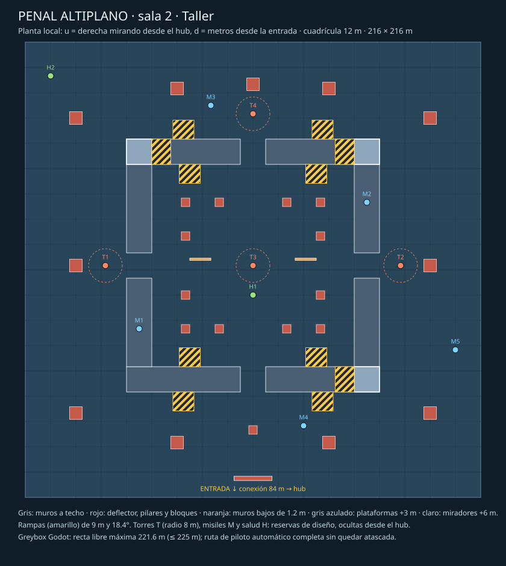
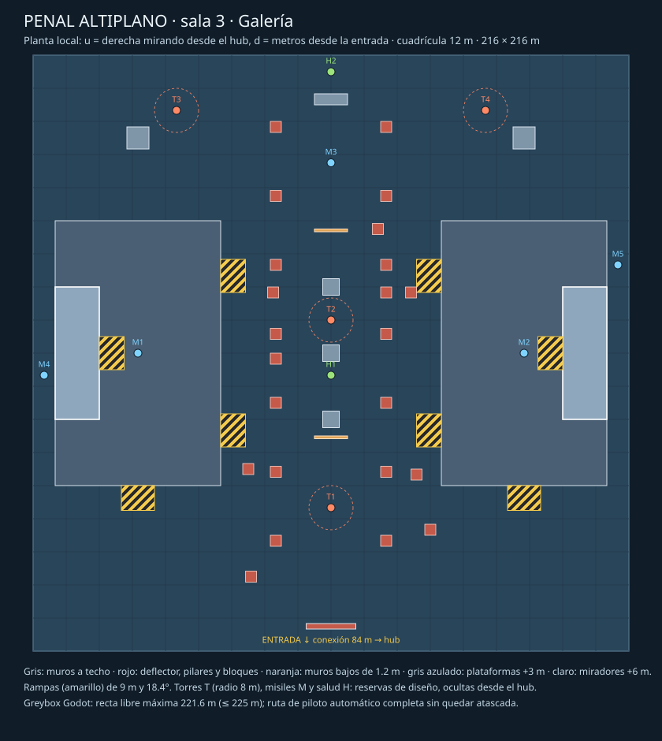
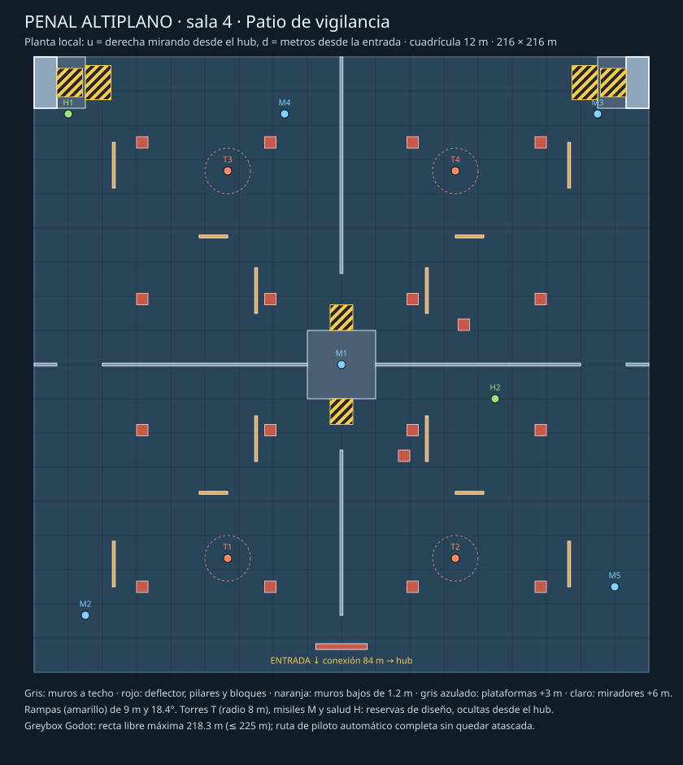

# Dominio 1 · Penal Altiplano

## Concepto (2 líneas)
Prisión de la meseta: hormigón, acero azul y señalética verde.
Cuatro patios cubiertos enseñan conducción, salto, cobertura y regreso al portal.

## Modificador
Ninguno. Tutorial implícito según [diseño de dominios](../04_DOMINIOS_Y_NIVELES.md).
**Estado: PUR-070 rev. 4 (2026-11-06), escala oficial.** Gerson adoptó la escala ×6 en largo para salas y conexiones (×3 para el hub) y subió láser (150 m) y Purga (10 m/s). El hub, el podio y la sala 1 están construidos como greybox en `game/levels/domain_01/` y verificados con física real. Las secciones «Base histórica» describen la escala ×1 anterior y solo sirven de referencia. Las salas 2–4 siguen siendo solo envolventes.

## Escala oficial (rev. 4)

| Elemento | Medida |
|---|---|
| Hub | Ø120 m, techo 6 m, óculo Ø12 sobre el portal; podio, rampas del podio y spawns sin cambios (ver «Hub y podio») |
| Conexiones | 84 m de largo, 8 m de ancho, 5 m de alto; compuertas de 8 × 5 m |
| Sala 1 | 216 × 216 m, techo 12 m; centro a 252 m del centro del hub |
| Rampas interiores | 9 m de desarrollo, 3 m de subida (18.4°) |

Interior de la sala 1, en coordenadas locales (u = X del mundo, d = metros desde la entrada hacia el fondo). Las listas exactas están en las constantes `LARGE_*` de `penal_altiplano_greybox.gd`.

| Zona (d) | Contenido |
|---|---|
| Entrada (0–24) | Deflector de 18 × 2 m a 8 m de la entrada; rampas a las pasarelas oeste y este en las esquinas |
| Campo de pilares (32–78) | Pilares de 4 × 4 m cada 14 m en 4 filas, con calles rectas de 10 m |
| Banda central (85–143) | Plataforma de 40 × 40 m a +3 m con cuatro rampas; seis muros bajos de 1.2 m (saltables); cuatro bloques de 4 × 4 m |
| Cámaras del fondo (150–204) | Muro a techo con tres huecos de 16 m; dos tabiques con paso de 16 m; un bloque por cámara |
| Perímetro | Pasarelas de 12 m de ancho a +3 m en los muros oeste, este y norte; rampas de bajada desde la norte |

**Reservas de diseño**, sin comportamiento hasta que existan sus sistemas:
- 6 torres (T1–T6);
- 6 pickups de misil (M1–M6), dos de ellos en altura;
- 2 orbes de salud (H1–H2).

### Verificación (greybox, `tests/test_domain_01_greybox.gd`)

| Comprobación | Resultado |
|---|---|
| Dimensiones | Hub Ø120 m, conexión de 84 m y sala de 216 m, comprobados en la escena |
| Alturas y pendientes | Pasarelas y plataforma a 3 m; rampas a 18.4° |
| Techos | Sala 12 m, con 9 m libres sobre las pasarelas; óculo libre sobre el portal |
| Spawns | Casco + 0.2 m sin tocar rampas ni podio |
| Reservas ocultas | Ningún rayo desde 240 puntos del hub, a 0.5 m ni a 3.2 m, alcanza las 14 reservas |
| Recta libre más larga (0.5 m) | **219.5 m**, bajo el límite de 225 m (1.5 × láser). Con pilares de 2 m daba 241 m: por eso son de 4 × 4 m |
| Rutas (piloto automático, Amaru) | **A:** entrada → pasarela oeste → pasarela norte → cámaras → plataforma central → pilares → portal, en 52 s. **B:** entrada → pilares (calle este) → muros bajos → cámaras → oeste → portal, en 43 s. Sala 1 a 7.1 s del spawn |

**Pendiente:**
- playtest humano de la escala, sobre todo cuántos encuentros hay con 8 Runners;
- disparo saltando sobre el podio;
- torres reales, bots y rendimiento con ocho Runners en salas de 216 m.

## Salas 2–4 (escala oficial, 2026-11-06)

Mismo formato que la sala 1: 216 × 216 m, techo de 12 m, deflector de 18 × 2 m a 8 m de la entrada, plataformas a +3 m con rampas de 9 m (18.4°). Coordenadas locales: u a la derecha mirando desde el hub, d desde la entrada. Las listas exactas están en `LARGE_ROOMS` de `penal_altiplano_greybox.gd`. Las compuertas por ronda (R1: 1–2 / R2: +3 / R3: +4) todavía no existen (PUR-036): en el greybox las cuatro salas están abiertas.

| Sala | Abre | Identidad | Altura | Coberturas | Reservas |
|---|---|---|---|---|---|
| 2 · Taller | R1 | Anillo elevado de 120 × 120 m (12 m de ancho) con huecos a ras de suelo en sus cuatro lados; máquinas (bloques de 6 × 6 m) alrededor | Anillo +3 m, 4 rampas exteriores | 13 pilares interiores del anillo, 11 bloques perimetrales, 2 muros bajos | 4 T, 5 M (2 en el anillo), 2 H |
| 3 · Galería | R2 | Dos plataformas laterales de 60 × 96 m unidas por una galería central de columnas; canales de 8 m junto a los muros | 2 plataformas +3 m, 6 rampas | 23 pilares en la galería, 3 bloques centrales, 2 muros bajos, 3 bloques al fondo | 4 T, 5 M (2 en altura), 2 H |
| 4 · Patio de vigilancia | R3 | Cruz de muros unida a una torre central de 24 × 24 m que divide cuatro patios. Se pasa entre patios por portones de 16 m junto a los muros laterales y por pasos de 9 m al pie de las rampas de la torre | Torre +3 m, 2 rampas | 18 pilares, 12 muros bajos alternados (horizontales y verticales) | 4 T, 5 M (1 en la torre), 2 H |

### Verificación de las salas 2–4

| Comprobación | Resultado |
|---|---|
| Recta libre más larga (barrido 3D de todo el dominio) | **220.5 m** ≤ 225 m. Por sala, en 2D: sala 2 221.6 m, sala 3 221.6 m, sala 4 218.3 m |
| Reservas ocultas desde el hub | Las 47 del dominio |
| Contenido mínimo por sala (prueba) | 4–6 torres, ≥ 5 secundarias, ≥ 2 orbes de salud, zona de altura, ≥ 12 pilares |
| Rutas de piloto automático (Amaru) | Sala 2: 45 s · Sala 3: 50 s · Sala 4: 39 s. Las tres suben a altura y vuelven al portal; la sala correspondiente queda a 7.1 s del spawn |

**Cómo se diseñaron:** se iteró la planta con un cálculo 2D de rectas libres. Algunas coberturas se colocaron automáticamente en el punto medio de la recta más larga, siempre a ≥ 5 m de otros obstáculos y a ≥ 6 m de las rutas: 1 en la sala 2, 9 en la sala 3 y 2 en la sala 4. En la sala 4 no bastaba con pilares: hubo que unir la cruz de muros a la torre y llevar los portones junto a los muros laterales.

**Pendiente:**
- **Roces:** las rutas aún rozan el marco de la puerta al salir de cada sala.
- **Juego real:** compuertas por ronda, Purga por salas, bots y playtest de escala.

## Base histórica rev. 2–3 (escala ×1, sustituida)
Las secciones siguientes, hasta «Purga», documentan la escala anterior (sala de 36 m) y cómo se llegó a ella. El greybox todavía la construye con `--layout-scale=1 --hub-scale=1` para comparar.

Vista superior: norte = −Z, este = +X; Y vertical. Centro del hub (0,0,0).
El dibujo fija envolventes y conexiones; coberturas, desvíos interiores y navegación quedan para blockout.
No hay pasajes secundarios ni puertas de llave en esta primera versión.

| Elemento | Coordenadas / dimensiones propuestas |
|---|---|
| Hub | Centro X/Z (0,0), diámetro 40 m |
| Portal | Centro (0,0), diámetro 10 m, podio 1.5 m; cuatro rampas en ejes cardinales (ver «Hub y podio») |
| Salas 1/2/3/4 | Centros (0,−52), (52,0), (0,52), (−52,0); cada una 36×36 m |
| Conexiones | Desde radio 20 hasta borde de sala a 34 m; longitud nominal 14 m, ancho 8 m |
| Compuertas | Umbrales cardinales del hub, 8×5 m; ajustar encuentro con pared curva sin grietas |
| Techo base | Conexiones 5 m; hub 6 m con óculo Ø12 m sobre el portal; sala 1 a 6 m en toda su planta |
| Alturas | Plataformas de 2 m; rampas de 6 m de desarrollo horizontal (18.4°), ancho 8 m |
| Spawns | Ocho puntos a radio 7 m, **±30°** respecto a cada eje cardinal, mirando afuera (rev. 2; antes ±22.5°) |

## Hub y podio (rev. 2)

| Elemento | Medida | Comprobación en planta |
|---|---|---|
| Rampas del podio | 4, una por eje cardinal (de frente a cada compuerta); 4 m de ancho, de r = 5 m a r = 9.5 m (4.5 m de desarrollo, 1.5 m de subida) | 18.4° ≤ 25° (docs/04) y ≤ 30° (`floor_max_angle_deg`) |
| Arranque de rampa | Rectángulo desde r = 4.6 m para enrasar con el borde curvo del podio (flecha de 0.4 m en cuerda de 4 m) | Sin escalón en planta; revisar soldadura en blockout |
| Spawns | 8 a r = 7 m, ±30° del eje de cada compuerta | Huelgo mínimo de la huella del Runner (1 × 2.2 m) al borde de rampa: 0.52 m. Con ±22.5° se solapaba (−0.2 m): por eso cambia el ángulo |
| Separación entre spawns | 7.0 m dentro del par de cada compuerta y 3.6 m entre pares vecinos (centro a centro) | Salidas divergentes; medir con ocho Runners reales |
| Pie de rampa → umbral | 10.5 m de suelo llano | Espacio para girar hacia el portal al volver |
| Techo y óculo | Anillo a 6 m; óculo Ø12 m abierto ≥ 14 m sobre el portal (podio 1.5 m + ascenso 12 m) | Sobre la rampa a r = 6 m quedan ≈1.6 m libres por encima de un Runner en el ápice del salto |

Las rampas de frente a cada compuerta hacen recto el regreso al portal: umbral → rampa → portal. El borde del podio sin rampa (1.5 m) se puede saltar (ápice 2.5 m).

## Áreas
Pickups/torres son reservas de diseño hasta implementar sus sistemas; no usar nodos ficticios como si funcionaran.

| Área | Tema | Ronda que abre | Pickups | Torres | Llave | Notas |
|---|---|---|---|---|---|---|
| 0 | Patio central | Siempre | 0 | 0 | No | Sin coberturas; SafeZone hasta umbrales, relojes y portal visibles |
| 1 | Patio de ingreso | R1 | 3 de misil + 1 salud | 2 | No | Plataforma lateral, dos rutas alrededor de cobertura |
| 2 | Taller | R1 | 3 de misil + 1 salud | 2 | No | Pilares y circuito de rampas, sin callejones |
| 3 | Galería | R2 | 4 de misil + 1 salud | 3 | No | Dos plataformas conectadas por recorrido de suelo |
| 4 | Patio de vigilancia | R3 | 4 de misil + 1 salud | 3 | No | Cruces y cobertura alternada, regreso legible al hub |

Distribuir coberturas cada 10–15 m dentro de salas; mantener pasos de 7–9 m.
Torres alejadas de entradas, ocultas a rayos desde el hub por deflectores interiores.
Un deflector en cada sala debe cortar la recta axial antes de 60 m y ofrecer dos pasos laterales, sin tapar el número de área.
**Las coordenadas de deflectores, torres y pickups deben fijarse y probarse en el blockout:** este plano no certifica aún líneas de tiro.
Las coordenadas concretas de la sala 1 están en la sección siguiente; las salas 2–4 se resolverán en entregas aparte.
Compuertas cerradas sólidas y rojas; número ≥3 m visible desde hub; salida rotulada “SALIDA ↓ 0”.

## Sala 1 · Patio de ingreso: interior (rev. 3)

Coordenadas en metros del mundo. La sala ocupa X −18…18, Z −70…−34; su entrada (conexión de 8 m) desemboca en Z = −34, X −4…4. «Bloque» significa sólido hasta el techo (6 m), para que corte también la línea de tiro de un Runner que salta.

| Elemento | Posición (X; Z) | Notas |
|---|---|---|
| Deflector D1 | X −9…9; Z −44…−42 (18 × 2 m, bloque) | Cara frontal a 8 m de la entrada. Deja dos pasos de 9 m: oeste X −18…−9 y este X 9…18 |
| Plataforma P1 | X −18…−10; Z −70…−54, +2 m | Bordes este y sur abiertos (caída de 2 m), sin callejón |
| Rampa RA | X −18…−10; Z −54…−48, sube hacia el norte | 8 m de ancho, 6 m de desarrollo, 18.4°; 4 m de suelo entre D1 y su pie |
| Pilar C1 | X −2…0; Z −59…−57 (bloque 2 × 2) | 8 m hasta el borde de P1 y 9 m hasta C2 |
| Pilar C2 | X 9…11; Z −63…−61 (bloque 2 × 2) | 7 m hasta la pared este y 7 m hasta la pared norte |
| Torre T1 | (−7; −50) | Junto a la rampa RA, a 17 m de la entrada |
| Torre T2 | (14; −50) | Cruce del paso este con el suelo norte; a 21 m de T1 (sin cadena) |
| Misiles M1 / M2 / M3 | (−14; −64) en P1 · (4; −68) · (15; −62) | Reserva de diseño: el sistema de pickups (PUR-040) no existe todavía |
| Salud H1 | (−1; −66) | Detrás de C1 |

Separación entre coberturas (D1 → C1 → C2): 15.0 m y 11.7 m, dentro del rango de 10–15 m.

**Dos rutas de paso (lazos alrededor de D1):**
- **Ruta A, alta:** entrada → paso oeste → rampa RA → P1 (M1) → caída por el borde este → corredor norte entre C1/C2 y la pared → paso este → salida.
- **Ruta B, suelo:** entrada → paso este (T2) → franja Z −46…−56 entre D1 y C1 → junto a la rampa (T1) → paso oeste → salida.

Desde la entrada, ambos pasos laterales vuelven a la conexión; no hay callejones a menos de 10 m de la puerta.

### Comprobaciones en planta (2D, rev. 3)
Script de muestreo sobre el hub, las cuatro conexiones (cerradas en el borde de las salas 2–4) y la sala 1, con D1, C1, C2, el podio y sus rampas como obstáculos a ras de suelo.

| Criterio | Resultado |
|---|---|
| Línea recta libre más larga | **59.0 m** (cara frontal de D1 → por la conexión → pared del hub) ≤ 60 m. Contando las rampas del podio, D1 puede ir a 8 m de la entrada; a 10 m daba 61.2 m |
| Cono visible desde el hub | Cualquier línea hub→sala tiene \|ΔX/ΔZ\| ≤ 8/14; en Z = −42 alcanza \|X\| ≤ 8.6 m < 9 m (semiancho de D1). Nada al norte de D1 es visible desde el hub |
| Torres y pickups visibles desde el Área 0 | Ninguno (T1, T2, M1–M3, H1) |
| Anchos | Pasos laterales de 9 m, entre C1 y C2 9 m, de C2 a las paredes 7 m: dentro de 7–9 m |
| Pendientes | Rampas del podio y RA: 18.4° |
| Diagonal interior de la sala | 50.9 m ≤ 60 m |

### Greybox: verificación física (rev. 3)
Escena `res://levels/domain_01/penal_altiplano_sandbox.tscn`, construida por código desde las constantes de `penal_altiplano_greybox.gd` (mismas cotas que esta ficha). Pruebas en `tests/test_domain_01_greybox.gd`.

| Comprobación | Resultado |
|---|---|
| Alturas y pendientes (rayos) | Podio 1.5 m, P1 2 m, cuatro rampas del podio y RA a 18.4° |
| Techos | Hub 6 m, conexión 5 m, sala 1 6 m; óculo libre sobre el portal más allá de los 12 m de ascenso; holgura de salto sobre P1 |
| Spawns | Casco del Runner + 0.2 m por lado sin tocar rampas ni podio en los 8 puntos |
| Reservas ocultas | Ningún rayo desde 192 puntos del hub, a 0.5 m y a 3.2 m (ápice de salto), alcanza T1, T2, M1–M3 ni H1 |
| Línea libre más larga (3D, 0.5 m) | **59.1 m** < 60 m, barrido de 180 direcciones desde una malla de 2 m |
| Rutas A y B (piloto automático, Amaru) | Ambas completas; sala 1 a **2.3–2.4 s** del spawn (objetivo ≤ 6 s); ruta A sube a P1 y las dos vuelven al podio |

**Cambios respecto a la rev. 2, motivados por la prueba física:**
- **Deflector a 6 m: inviable sin frenar del todo.** El radio de giro a velocidad máxima es de 10–13 m según el Runner; el piloto chocaba cinco veces con D1. Pasó a 8 m de la entrada y 18 m de ancho; con frenada previa a la curva (hasta 14 m/s) ya no lo toca. Entrar a la sala exige frenar: es un cambio de ritmo buscado, a validar con jugadores.
- **Paso de 2 m entre D1 y la rampa RA:** la ruta B rozaba en él. P1 y RA retroceden 2 m (P1 queda de 8 × 16 m) y el paso es de 4 m.
- **Juntas de suelo:** las losas solapadas del hub, la conexión y la sala enganchaban el morro del Runner. Ahora hay un único suelo de colisión.

**Sigue pendiente:**
- **Roces del piloto:** el piloto aún roza el lateral de RA (ruta B) y el borde de P1 al caer (ruta A). Biselar el lateral de la rampa o poner bordillo cuando haya kit de arte.
- **Sin medir todavía:** disparo saltando sobre el podio, explosión real de las torres (no existen), navegación de bots, cámara lejana bajo techo de 6 m, mando físico y sensación de juego (requiere playtest humano), rendimiento con ocho Runners. Nada de esto se extrapola a las salas 2–4.

## Rutas principales (Área 0 → cada sala, tiempo a vel. 23.5 m/s)

Las cuatro rutas son simétricas en planta. Son cotas inferiores de distancia, sin aceleración, desvíos ni obstáculos.

| Tramo | Distancia nominal | Tiempo ideal |
|---|---:|---:|
| Centro del hub → umbral | 20 m | 0.85 s |
| Umbral → entrada de sala | 14 m | 0.60 s |
| Centro del hub → centro de sala | 52 m | 2.21 s |
| Spawn → centro de sala (distancia recta) | 45.61 m | 1.94 s |

El centro contiene el portal: las rutas reales lo rodean. Medir desde spawns con Runner real; aceptación: cada sala alcanzable en ≤6 s a velocidad media. No presentar estos tiempos ideales como playtest.

## Puntos calientes esperados
- Salas 1–2: combate inicial por misiles, salida rápida del hub.
- Rampas y cruces: barreras esquivables, torres como riesgo legible.
- Retorno al portal tras cuota: entradas visibles y sin torres con línea directa al hub.

## Purga: contrato para implementación
**Implementado (2026-11-06)**, con portal, cuota y puntaje integrados en la escena (`--quota-preview`: caza de dos blancos y ascenso; `--purge-preview`: huida y ascenso), en `round/domain_purge_field.gd`, con `AreaTracker` y `GateController` en la escena del greybox (`--round=N`, `--purge-preview`). Pruebas en `tests/test_domain_rounds.gd`. La huida de prueba, desde el fondo de la sala 1 hasta el hub, tarda 17.4 s; un Runner que se queda en la sala muere.

Propuesta (rev. 4):
- Un frente por sala abierta, desde el borde exterior de la sala hasta el umbral del hub: 216 m de sala + 84 m de conexión = 300 m a 10 m/s, unos 30 s.
- Después, cierre del hub en 10 s.
- Aviso a 0:30.
- Un Runner en el fondo de la sala necesita unos 13 s a 23.5 m/s para llegar al hub, y el frente avanza más despacio que el Runner más lento.
Cada frente debe barrer sala y conexión completas, incluidos rampas, pisos y plataformas; delimitar su volumen para no matar prematuramente en salas vecinas.
Salas cerradas no deben poder contener participantes ni generar refugios. El frente radial del sandbox queda separado.
La forma exacta, sincronización y cobertura deben verificarse con geometría física; no reutilizar radio 56/7 del ensayo como dimensiones del dominio.
D8 conserva su multiplicador previsto; no se aplica en Dominio 1.

## Riesgos (dónde se puede quedar atascado un bot o un jugador)
- Encuentros entre círculo del hub y conexiones rectangulares: soldar suelos, revisar esquinas.
- Podio: rampas y anillo de spawns no deben bloquearse mutuamente; probar ocho salidas.
- Deflectores: pueden crear callejones o rutas excesivas; ofrecer paso a ambos lados.
- Plataforma/techo: verificar salto y cámara con volumen real del Runner.
- Simetría: señalética y siluetas propias por sala para orientar al jugador.

## Entrega siguiente
1. ~~Greybox del hub + sala 1~~: hecho en rev. 3. Falta el playtest humano de la entrada a la sala 1 (frenada ante D1).
2. Después, interiores de las salas 2–4 con el mismo método (deflector a ≤6 m de la entrada o equivalente, comprobación de 60 m).
3. AreaTracker PUR-032 y compuertas PUR-036 por bloques separados; después navegación y Purga del dominio.
4. Bots, 20 partidas sin atascos y benchmark con ocho Runners siguen pendientes; no marcar PUR-071 completo antes de comprobarlos.

PUR-070 sigue siendo una propuesta documental: falta la aprobación de diseño y las salas 2–4 no tienen interior.
