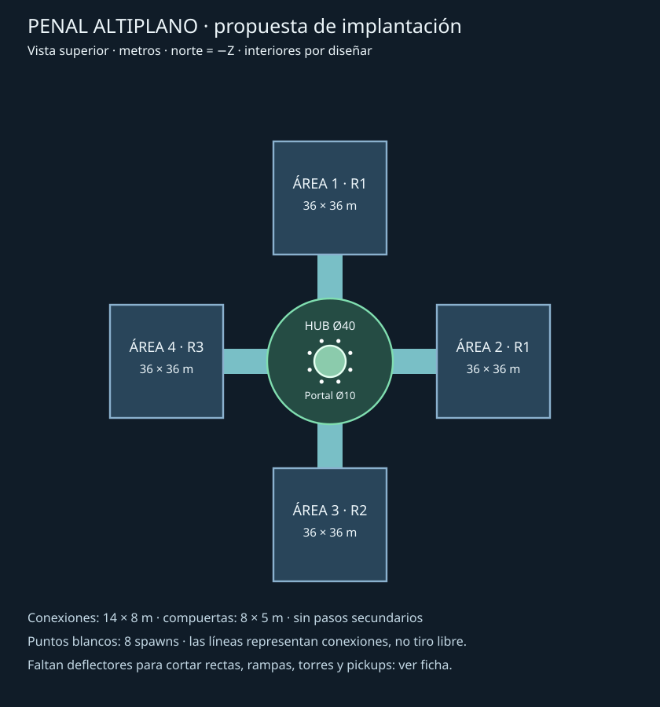

# Dominio 1 · Penal Altiplano

## Concepto (2 líneas)
Prisión de la meseta: hormigón, acero azul y señalética verde.
Cuatro patios cubiertos enseñan conducción, salto, cobertura y regreso al portal.

## Modificador
Ninguno. Tutorial implícito según [diseño de dominios](../04_DOMINIOS_Y_NIVELES.md).
**Estado: propuesta PUR-070, rev. 2 (2026-11-06).** El hub, el acceso al podio y el interior de la sala 1 tienen coordenadas; las salas 2–4 siguen siendo solo envolventes. Es un plano, no un nivel construido, y ninguna métrica de juego está certificada. No cambia balance.

## Plano (imagen en docs/dominios/img/)

Vista superior: norte = −Z, este = +X; Y vertical. Centro del hub (0,0,0).
El dibujo fija envolventes y conexiones; coberturas, desvíos interiores y navegación quedan para blockout.
No hay pasajes secundarios ni puertas de llave en esta primera versión.

| Elemento | Coordenadas / dimensiones propuestas |
|---|---|
| Hub | Centro X/Z (0,0), diámetro 40 m |
| Portal | Centro (0,0), diámetro 10 m, podio 1.5 m; cuatro rampas en ejes cardinales (ver «Hub y podio») |
| Salas 1/2/3/4 | Centros (0,−52), (52,0), (0,52), (−52,0); cada una 36×36 m |
| Conexiones | Desde radio 20 hasta borde de sala a 34 m; longitud nominal 14 m, ancho 8 m |
| Compuertas | Umbrales cardinales del hub, 8×5 m; ajustar encuentro con pared curva sin grietas |
| Techo base | Conexiones 5 m; hub 6 m con óculo Ø12 m sobre el portal; sala 1 a 6 m en toda su planta |
| Alturas | Plataformas de 2 m; rampas de 6 m de desarrollo horizontal (18.4°), ancho 8 m |
| Spawns | Ocho puntos a radio 7 m, **±30°** respecto a cada eje cardinal, mirando afuera (rev. 2; antes ±22.5°) |

## Hub y podio (rev. 2)

| Elemento | Medida | Comprobación en planta |
|---|---|---|
| Rampas del podio | 4, una por eje cardinal (de frente a cada compuerta); 4 m de ancho, de r = 5 m a r = 9.5 m (4.5 m de desarrollo, 1.5 m de subida) | 18.4° ≤ 25° (docs/04) y ≤ 30° (`floor_max_angle_deg`) |
| Arranque de rampa | Rectángulo desde r = 4.6 m para enrasar con el borde curvo del podio (flecha de 0.4 m en cuerda de 4 m) | Sin escalón en planta; revisar soldadura en blockout |
| Spawns | 8 a r = 7 m, ±30° del eje de cada compuerta | Huelgo mínimo de la huella del Runner (1 × 2.2 m) al borde de rampa: 0.52 m. Con ±22.5° se solapaba (−0.2 m): por eso cambia el ángulo |
| Separación entre spawns | 7.0 m dentro del par de cada compuerta y 3.6 m entre pares vecinos (centro a centro) | Salidas divergentes; medir con ocho Runners reales |
| Pie de rampa → umbral | 10.5 m de suelo llano | Espacio para girar hacia el portal al volver |
| Techo y óculo | Anillo a 6 m; óculo Ø12 m abierto ≥ 14 m sobre el portal (podio 1.5 m + ascenso 12 m) | Sobre la rampa a r = 6 m quedan ≈1.6 m libres por encima de un Runner en el ápice del salto |

Las rampas de frente a cada compuerta hacen recto el regreso al portal: umbral → rampa → portal. El borde del podio sin rampa (1.5 m) se puede saltar (ápice 2.5 m).

## Áreas
Pickups/torres son reservas de diseño hasta implementar sus sistemas; no usar nodos ficticios como si funcionaran.

| Área | Tema | Ronda que abre | Pickups | Torres | Llave | Notas |
|---|---|---|---|---|---|---|
| 0 | Patio central | Siempre | 0 | 0 | No | Sin coberturas; SafeZone hasta umbrales, relojes y portal visibles |
| 1 | Patio de ingreso | R1 | 3 de misil + 1 salud | 2 | No | Plataforma lateral, dos rutas alrededor de cobertura |
| 2 | Taller | R1 | 3 de misil + 1 salud | 2 | No | Pilares y circuito de rampas, sin callejones |
| 3 | Galería | R2 | 4 de misil + 1 salud | 3 | No | Dos plataformas conectadas por recorrido de suelo |
| 4 | Patio de vigilancia | R3 | 4 de misil + 1 salud | 3 | No | Cruces y cobertura alternada, regreso legible al hub |

Distribuir coberturas cada 10–15 m dentro de salas; mantener pasos de 7–9 m.
Torres alejadas de entradas, ocultas a rayos desde el hub por deflectores interiores.
Un deflector en cada sala debe cortar la recta axial antes de 60 m y ofrecer dos pasos laterales, sin tapar el número de área.
**Las coordenadas de deflectores, torres y pickups deben fijarse y probarse en el blockout:** este plano no certifica aún líneas de tiro.
Las coordenadas concretas de la sala 1 están en la sección siguiente; las salas 2–4 se resolverán en entregas aparte.
Compuertas cerradas sólidas y rojas; número ≥3 m visible desde hub; salida rotulada “SALIDA ↓ 0”.

## Sala 1 · Patio de ingreso: interior (rev. 2)

Coordenadas en metros del mundo. La sala ocupa X −18…18, Z −70…−34; su entrada (conexión de 8 m) desemboca en Z = −34, X −4…4. «Bloque» significa sólido hasta el techo (6 m), para que corte también la línea de tiro de un Runner que salta.

| Elemento | Posición (X; Z) | Notas |
|---|---|---|
| Deflector D1 | X −10…10; Z −42…−40 (20 × 2 m, bloque) | Cara frontal a 6 m de la entrada. Deja dos pasos de 8 m: oeste X −18…−10 y este X 10…18 |
| Plataforma P1 | X −18…−10; Z −70…−52, +2 m | Bordes este y sur abiertos (caída de 2 m), sin callejón |
| Rampa RA | X −18…−10; Z −52…−46, sube hacia el norte | 8 m de ancho, 6 m de desarrollo, 18.4°; el paso oeste lleva recto a ella |
| Pilar C1 | X −2…0; Z −59…−57 (bloque 2 × 2) | 8 m hasta el borde de P1 y 9 m hasta C2 |
| Pilar C2 | X 9…11; Z −63…−61 (bloque 2 × 2) | 7 m hasta la pared este y 7 m hasta la pared norte |
| Torre T1 | (−7; −50) | Junto a la rampa RA, a 17 m de la entrada |
| Torre T2 | (14; −50) | Cruce del paso este con el suelo norte; a 21 m de T1 (sin cadena) |
| Misiles M1 / M2 / M3 | (−14; −64) en P1 · (4; −68) · (15; −62) | Reserva de diseño: el sistema de pickups (PUR-040) no existe todavía |
| Salud H1 | (−1; −66) | Detrás de C1 |

Separación entre coberturas (D1 → C1 → C2): 13.0 m y 11.7 m, dentro del rango de 10–15 m.

**Dos rutas de paso (lazos alrededor de D1):**
- **Ruta A, alta:** entrada → paso oeste → rampa RA → P1 (M1) → caída por el borde este → corredor norte entre C1/C2 y la pared → paso este → salida.
- **Ruta B, suelo:** entrada → paso este (T2) → franja Z −46…−56 entre D1 y C1 → pie de la rampa (T1) → paso oeste → salida.

Desde la entrada, ambos pasos laterales vuelven a la conexión; no hay callejones a menos de 10 m de la puerta.

### Comprobaciones en planta (2D, rev. 2)
Script de muestreo sobre el hub, las cuatro conexiones (cerradas en el borde de las salas 2–4) y la sala 1 con D1, C1 y C2 como obstáculos. El podio bloquea las líneas a ras de suelo.

| Criterio | Resultado |
|---|---|
| Línea recta libre más larga | **59.4 m** (cara frontal de D1 → por la conexión → pared del hub) ≤ 60 m. Con D1 a Z −44…−42 daba 61.5 m y con −43…−41 daba 60.4 m: por eso D1 queda a 6 m de la entrada |
| Cono visible desde el hub | Cualquier línea hub→sala tiene \|ΔX/ΔZ\| ≤ 8/14; en Z = −40 alcanza \|X\| ≤ 7.4 m < 10 m (semiancho de D1). Nada al norte de D1 es visible desde el hub |
| Torres y pickups visibles desde el Área 0 | Ninguno (T1, T2, M1–M3, H1) |
| Anchos | Pasos laterales de 8 m, entre C1 y C2 9 m, de C2 a las paredes 7 m: dentro de 7–9 m |
| Pendientes | Rampas del podio y RA: 18.4° |
| Diagonal interior de la sala | 50.9 m ≤ 60 m |

**Pendiente de verificar físicamente (blockout):** frenada y giro en los 6 m entre la entrada y D1 a 23.5 m/s; línea de tiro de un Runner que salta sobre el podio (las líneas entre compuertas opuestas cruzan el podio a \|X\| < 4 m); radio de explosión de 8 m de T1 sobre la rampa; caída desde P1 y techo de 6 m con la cámara lejana; colisión de los spawns con el volumen real del Runner; navegación de bots. Nada de esto se extrapola a las salas 2–4.

## Rutas principales (Área 0 → cada sala, tiempo a vel. 23.5 m/s)

Las cuatro rutas son simétricas en planta. Son cotas inferiores de distancia, sin aceleración, desvíos ni obstáculos.

| Tramo | Distancia nominal | Tiempo ideal |
|---|---:|---:|
| Centro del hub → umbral | 20 m | 0.85 s |
| Umbral → entrada de sala | 14 m | 0.60 s |
| Centro del hub → centro de sala | 52 m | 2.21 s |
| Spawn → centro de sala (distancia recta) | 45.61 m | 1.94 s |

El centro contiene el portal: las rutas reales lo rodean. Medir desde spawns con Runner real; aceptación: cada sala alcanzable en ≤6 s a velocidad media. No presentar estos tiempos ideales como playtest.

## Puntos calientes esperados
- Salas 1–2: combate inicial por misiles, salida rápida del hub.
- Rampas y cruces: barreras esquivables, torres como riesgo legible.
- Retorno al portal tras cuota: entradas visibles y sin torres con línea directa al hub.

## Purga: contrato para implementación
Propuesta: un frente por sala abierta, desde borde exterior a su umbral (50 m nominales a 3.5 m/s ≈14.29 s), seguido por cierre del hub en 10 s. Mantener aviso a 0:30.
Cada frente debe barrer sala y conexión completas, incluidos rampas, pisos y plataformas; delimitar su volumen para no matar prematuramente en salas vecinas.
Salas cerradas no deben poder contener participantes ni generar refugios. El frente radial del sandbox queda separado.
La forma exacta, sincronización y cobertura deben verificarse con geometría física; no reutilizar radio 56/7 del ensayo como dimensiones del dominio.
D8 conserva su multiplicador previsto; no se aplica en Dominio 1.

## Riesgos (dónde se puede quedar atascado un bot o un jugador)
- Encuentros entre círculo del hub y conexiones rectangulares: soldar suelos, revisar esquinas.
- Podio: rampas y anillo de spawns no deben bloquearse mutuamente; probar ocho salidas.
- Deflectores: pueden crear callejones o rutas excesivas; ofrecer paso a ambos lados.
- Plataforma/techo: verificar salto y cámara con volumen real del Runner.
- Simetría: señalética y siluetas propias por sala para orientar al jugador.

## Entrega siguiente
1. **Greybox del hub + sala 1** en una escena aparte (`game/levels/domain_01/`) con las coordenadas de rev. 2; conservar las escenas de ensayo. Medir con un Runner real los pendientes listados arriba y corregir el plano si algo falla.
2. Después, interiores de las salas 2–4 con el mismo método (deflector a ≤6 m de la entrada o equivalente, comprobación de 60 m).
3. AreaTracker PUR-032 y compuertas PUR-036 por bloques separados; después navegación y Purga del dominio.
4. Bots, 20 partidas sin atascos y benchmark con ocho Runners siguen pendientes; no marcar PUR-071 completo antes de comprobarlos.

PUR-070 sigue siendo una propuesta documental: falta la aprobación de diseño y las salas 2–4 no tienen interior.
